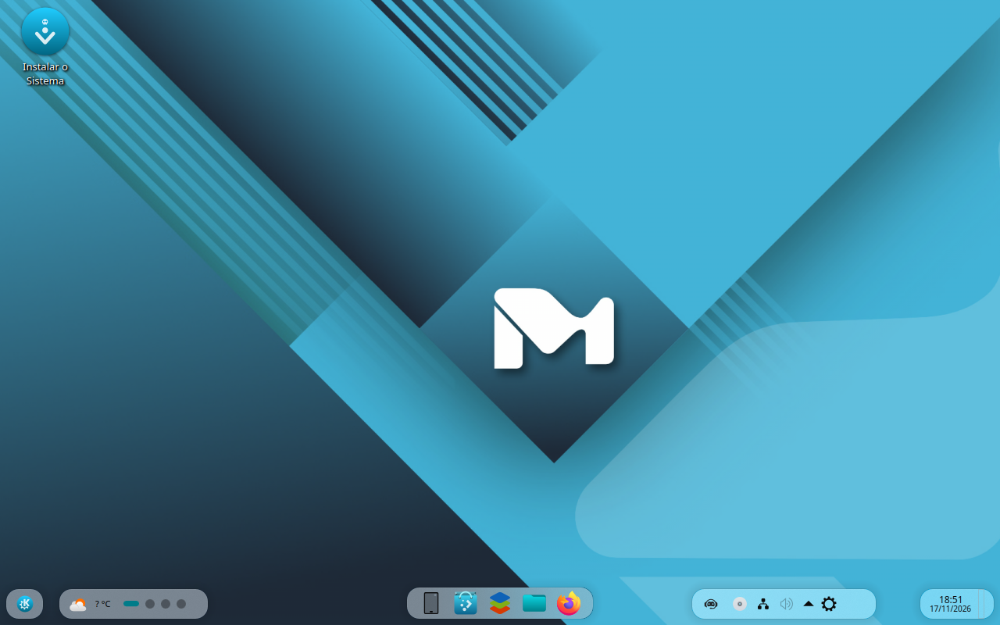
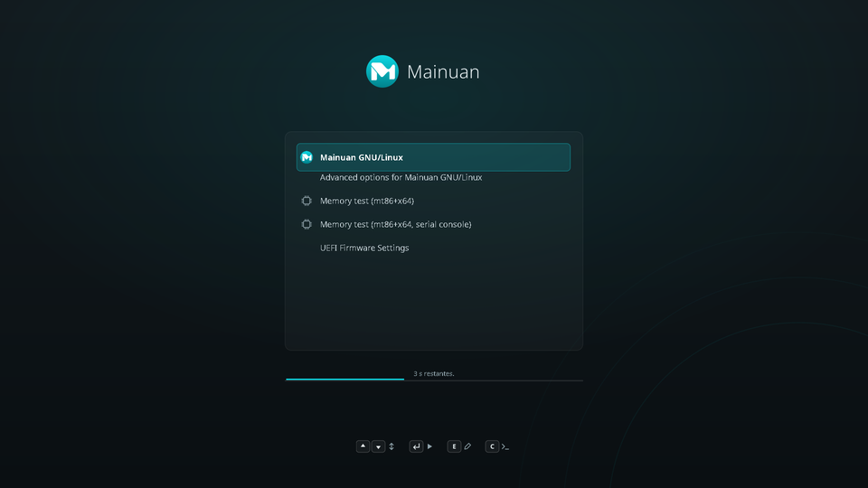

<div align="center">


# Mainuan Desktop Defaults

Initial Plasma desktop configuration of **Mainuan Linux**, packaged as `mainuan-desktop-defaults` and `mainuan-user-avatar`.

[](https://github.com/mainuan/dot-files/actions/workflows/ci.yml)
[](https://github.com/mainuan/dot-files/releases)
[](LICENSE)

[Português](README.md)

</div>

---

<p align="center"></p>


## What it is

The `rootfs/` tree defines what a new Mainuan account looks like. Both
packages ship with the Mainuan ISO:

- **`mainuan-desktop-defaults`**: `/etc/skel` (panels and widgets, Plasma
  style `Dream-Color-Plasma`, colour scheme `DreamCyanLightColor`, icon theme
  `kora-cyan`, `Lavanda-Light` window decoration, shortcuts, KWin, Dolphin,
  Kate and the `01ciano.png` wallpaper), the lock screen wallpaper in
  `/etc/xdg/kscreenlockerrc`, the ChatAI, Mike Desktop and Power Show Desktop
  widgets, the Mainuan avatar and the Calamares branding. It replaces no file
  of any other package.
- **`mainuan-grub-theme`**: the Mainuan GRUB menu theme (logo, graphite
  background, cyan selection, icons, translated countdown). It is copied to
  `/boot/grub/themes/mainuan` and enabled by
  `/etc/default/grub.d/60-mainuan-theme.cfg` only while it is installed.
- **`mainuan-plasma-splash`**: the "Mainuan" global theme
  (`org.mainuan.desktop`, the system default through `/etc/xdg/kdeglobals`)
  and its Plasma splash screen.
- The Plymouth boot screen (logo with a spinning ring, two-step) is part of
  `mainuan-desktop-defaults`. All boot artwork comes from
  `tools/boot-art/generate.py`; `tools/boot-art/preview-grub.sh` renders the
  GRUB theme in QEMU.
- **`mainuan-user-avatar`**: replaces Kubuntu's default user picture
  (`/etc/skel/.face`) and the `kubuntu-bug.png` avatar with the Mainuan logo
  using `dpkg-divert --rename`. The originals are kept in
  `/var/lib/mainuan-user-avatar/diverted`, still receive Kubuntu updates and
  are restored when the package is removed.

`/etc/skel` is copied only when an account is created; existing accounts do
not change.

## Installation

Download the `.deb` files and `SHA256SUMS` from the
[latest release](https://github.com/mainuan/dot-files/releases/latest):

```bash
sha256sum --check --ignore-missing SHA256SUMS
sudo apt install ./mainuan-desktop-defaults_*_all.deb ./mainuan-user-avatar_*_all.deb \
                 ./mainuan-grub-theme_*_all.deb ./mainuan-plasma-splash_*_all.deb
```

| GRUB | Plymouth | Plasma |
|---|---|---|
|  |  |  |

## Build and tests

```bash
dpkg-buildpackage -us -uc -b
```

The [CI](.github/workflows/ci.yml) builds both packages in Ubuntu 26.04, runs
`lintian`, installs the main package next to `kubuntu-settings-desktop`,
checks that Kubuntu's files are untouched, parses the 14 configuration files,
checks the three widgets and the effective wallpapers, then reinstalls,
removes and purges it. A separate job tests the diversions in both install
orders and checks that removal restores Kubuntu's files byte for byte. A
`v<version>` tag publishes both `.deb` files and `SHA256SUMS`.

## Credits and license

Mainuan contributors: Natanael Barbosa Santos
([natanael-art](https://github.com/natanael-art)), Rafael Ruscher
([ruscher](https://github.com/ruscher)) and Daigo
([daigoasuka](https://github.com/daigoasuka)).

Third-party widgets, as recorded in [`debian/copyright`](debian/copyright):

- **ChatAI**: Denys Madureira (original author), Bruno Gonçalves, Rafael
  Ruscher, Sora Steenvoort and contributors. SPDX headers say GPL-2.0-only OR
  GPL-3.0-only, `metadata.json` says GPL-2.0-or-later, while the widget's
  `LICENSE` file carries Denys Madureira's BSD 3-clause license; both are
  reproduced. Service icons come from Icons8, IconScout, Simple Icons and the
  services' owners.
- **Mike Desktop**: MikeDevQH, GPL-3.
- **Power Show Desktop**: Leonardo Pimenta, with code from Plasma's "Show
  Desktop" widget; AGPL-3 (`LICENSE`) and GPL-2+ (derived files).

The Mainuan configuration and images are licensed under the
[GNU GPL version 3](LICENSE).
