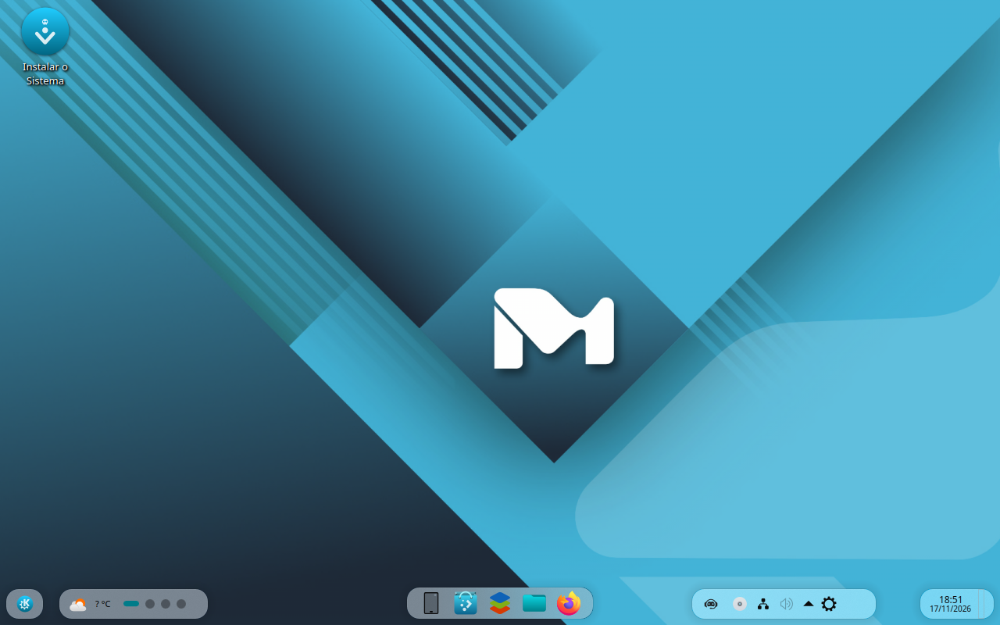
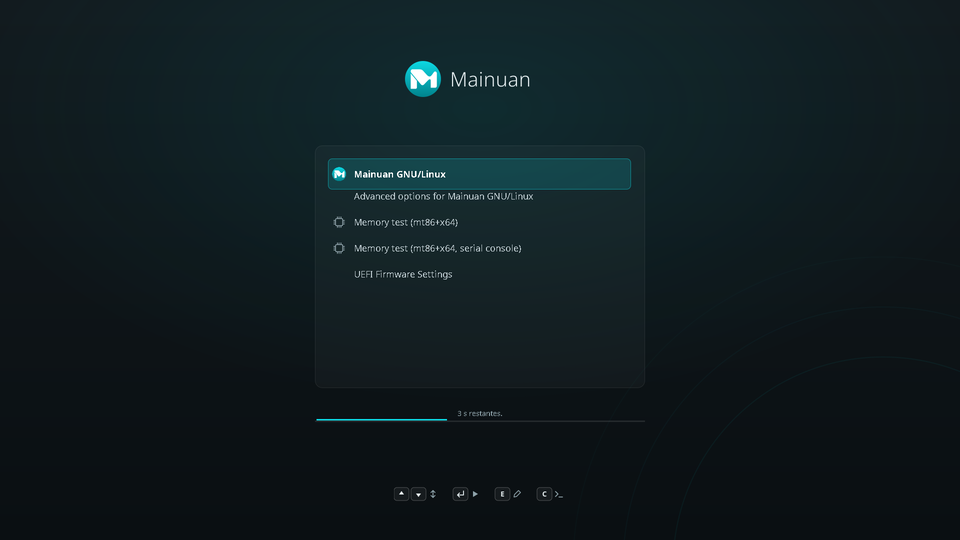

<div align="center">


# Mainuan Desktop Defaults

Configuração inicial da área de trabalho Plasma do **Mainuan Linux**, empacotada como `mainuan-desktop-defaults` e `mainuan-user-avatar`.

[](https://github.com/mainuan/dot-files/actions/workflows/ci.yml)
[](https://github.com/mainuan/dot-files/releases)
[](LICENSE)


[English](README.en.md)

</div>

---

<p align="center"></p>


## O que é

Este repositório define como a área de trabalho do Mainuan se apresenta numa
conta nova: painéis e widgets, tema, cores, ícones, papel de parede, atalhos
e as configurações iniciais do KWin, do Dolphin e do Kate. A árvore `rootfs/`
e a pasta `identity/` são instaladas por cinco pacotes Debian:

- **`mainuan-desktop-defaults`**: a configuração inicial, os widgets, a tela
  de login e a tela de inicialização (Plymouth). Não substitui nenhum arquivo
  de outro pacote.
- **`mainuan-user-avatar`**: troca a imagem de usuário padrão do Kubuntu pelo
  logotipo do Mainuan, com `dpkg-divert` (veja abaixo).
- **`mainuan-identity`**: a pasta oficial de identidade visual
  (`/usr/share/mainuan/identity`) e o serviço que a restaura no boot (veja
  abaixo).
- **`mainuan-grub-theme`**: o tema do menu do GRUB.
- **`mainuan-plasma-splash`**: o tema global "Mainuan" e a tela de
  apresentação do Plasma.

Os cinco pacotes vêm instalados na ISO do Mainuan. Os temas, ícones e papéis de
parede referenciados pela configuração vêm de outros pacotes, recomendados
pelo `mainuan-desktop-defaults`:
[`mainuan-plasma-themes`](https://github.com/mainuan/plasma-themes),
[`mainuan-icon-themes`](https://github.com/mainuan/icons) e
[`mainuan-wallpapers`](https://github.com/mainuan/wallpapers).

## Do ligar à área de trabalho

| GRUB | Plymouth | Plasma |
|---|---|---|
|  |  |  |

As três telas usam a mesma arte, gerada por
[`tools/boot-art/generate.py`](tools/boot-art/generate.py) a partir do
logotipo oficial: fundo grafite (`#121a1e` → `#0a0f12`), destaque ciano
(`#0dd8e3`) e um anel fino que gira em volta do logotipo.

- **GRUB** (`mainuan-grub-theme`): logotipo e nome, menu com ícones por tipo
  de sistema, contagem regressiva traduzida pelo próprio GRUB e dicas de
  teclado só com símbolos. O tema é copiado para `/boot/grub/themes/mainuan`.
  [`/etc/default/grub.d/60-mainuan-theme.cfg`](rootfs/etc/default/grub.d/60-mainuan-theme.cfg)
  mostra o menu por 3 segundos, prefere 1920x1080 e procura outros sistemas,
  mas só enquanto o tema estiver instalado. Sem modo gráfico, vale o menu em
  texto do GRUB.
- **Plymouth** (`mainuan-desktop-defaults`): tema two-step com o logotipo e
  o anel (48 quadros), caixa de senha de disco abaixo do logotipo e tema texto
  `mainuan-text`. A última imagem fica na tela até o login aparecer
  (`plymouth quit --retain-splash`).
- **Plasma** (`mainuan-plasma-splash`): tema global `org.mainuan.desktop`,
  padrão do sistema em `/etc/xdg/kdeglobals`, com a tela de apresentação em
  QML: o mesmo logotipo e anel, sem espera artificial, sem animação quando
  as animações do Plasma estão desligadas.

Para ver o tema do GRUB sem reiniciar: `tools/boot-art/preview-grub.sh
saida.png uefi 1920x1080 dual` (QEMU, GRUB real, sem tocar no bootloader do
computador).

Para voltar ao padrão do Kubuntu:

```bash
sudo apt remove mainuan-grub-theme                          # menu do GRUB
sudo update-alternatives --config default.plymouth && sudo update-initramfs -u
# Plasma: Configurações do sistema > Cores e temas > Tema global / Tela de apresentação
```

## O que a configuração define

| Item | Valor padrão | Arquivo |
|---|---|---|
| Tema do Plasma | `Dream-Color-Plasma` | `/etc/skel/.config/plasmarc` |
| Esquema de cores | `DreamCyanLightColor` (Ciano Claro) | `/etc/skel/.config/kdeglobals` |
| Tema de ícones | `kora-cyan` | `/etc/skel/.config/kdeglobals` |
| Decoração de janelas | Aurorae `Lavanda-Light` | `/etc/skel/.config/kwinrc` |
| Papel de parede da área de trabalho | `/usr/share/wallpapers/01ciano.png` | `/etc/skel/.config/plasma-org.kde.plasma.desktop-appletsrc` |
| Papel de parede da tela de bloqueio | `/usr/share/wallpapers/01ciano.png` | `/etc/xdg/kscreenlockerrc` |
| Sessão | começa vazia, sem confirmar a saída | `/etc/skel/.config/ksmserverrc` |

O `/etc/skel` traz 13 arquivos de configuração em `.config` (`dolphinrc`,
`gtkrc`, `gtkrc-2.0`, `katerc`, `kdeglobals`, `kglobalshortcutsrc`,
`ksmserverrc`, `kwinrc`, `plasmarc`, `plasmashellrc`, `resetrc`, `plasma-nm`
e o leiaute dos painéis). O pacote também instala:

- os widgets **ChatAI** (`ChatAI-Plasmoid`), **Mike Desktop**
  (`com.mike.desktop`) e **Power Show Desktop**
  (`org.kde.plasma.powershowdesktop`) em `/usr/share/plasma/plasmoids`;
- o avatar `logoMainuan.png` em `/usr/share/plasma/avatars`;
- a identidade visual do instalador Calamares em
  `/etc/calamares/branding/vendor`.

O ChatAI abre, a partir do painel, serviços de chat na web escolhidos pelo
usuário.

O leiaute também referencia o **Laetum Control Center** (`local.laetum.controlcenter`),
fornecido por `painel-de-controle` (recomendado por este pacote), e o **Chaac Complete
Weather** (`Chaac.Complete.Weather`), um widget externo do KDE Store que deve estar
presente na imagem final. Esses dois componentes não são distribuídos por este
repositório. O verificador `tools/check-plasma-layout.py` mantém o inventário dos
widgets externos e valida os três widgets empacotados aqui.

O conteúdo de `/etc/skel` é copiado para a pasta pessoal **só quando uma conta
é criada**. Contas que já existem não mudam ao instalar ou atualizar o pacote.

## Instalação

Os pacotes já vêm na ISO do Mainuan. Para instalar ou atualizar à mão, baixe
os `.deb` e o `SHA256SUMS` da
[última release](https://github.com/mainuan/dot-files/releases/latest):

```bash
sha256sum --check --ignore-missing SHA256SUMS
sudo apt install ./mainuan-desktop-defaults_*_all.deb ./mainuan-user-avatar_*_all.deb \
                 ./mainuan-identity_*_all.deb \
                 ./mainuan-grub-theme_*_all.deb ./mainuan-plasma-splash_*_all.deb
```

O `mainuan-user-avatar` (que depende do `mainuan-identity`), o
`mainuan-identity`, o `mainuan-grub-theme` e o `mainuan-plasma-splash` são
opcionais. O GitHub Releases não é um repositório
APT: as atualizações chegam por novas versões dos pacotes ou pela ISO.

## Convivência com o Kubuntu

O Kubuntu guarda a própria configuração padrão no `kubuntu-settings-desktop`
(em `/usr/share/kubuntu-default-settings`). O Mainuan não altera esses
arquivos:

- **`mainuan-desktop-defaults`** só instala arquivos que nenhum outro pacote
  tem. Os valores do Mainuan em `/etc/skel/.config` e `/etc/xdg` têm
  prioridade sobre os do Kubuntu pela ordem normal de leitura do KConfig. O
  papel de parede padrão é definido nesses arquivos, em vez de trocar as
  imagens dos pacotes de papéis de parede do Kubuntu.
- **`mainuan-user-avatar`** substitui dois arquivos do
  `kubuntu-settings-desktop`, `/etc/skel/.face` (imagem de usuário das contas
  novas) e `/usr/share/plasma/avatars/kubuntu-bug.png` (avatar do seletor de
  imagens), usando `dpkg-divert --rename`:
  - os originais ficam em `/var/lib/mainuan-user-avatar/diverted` e continuam
    recebendo as atualizações do Kubuntu;
  - `/etc/skel/.face` passa a ser um arquivo regular (root:root 0644) criado
    pelo postinst a partir de `/usr/share/mainuan/identity/avatars/cyan.svg`.
    Ele não vai dentro do pacote, para que o dpkg não confunda dois arquivos
    de configuração no mesmo caminho, e não é um link: um link para fora da
    pasta pessoal viraria, nas contas novas, um `~/.face` que o Mainuan
    Welcome recusa ao trocar o avatar;
  - ao remover o pacote, os originais voltam ao lugar.

Para voltar à imagem de usuário do Kubuntu:

```bash
sudo apt remove mainuan-user-avatar
dpkg-divert --list | grep mainuan   # não mostra nada depois da remoção
```

## Identidade visual e restauração no boot

O `mainuan-identity` instala em `/usr/share/mainuan/identity` só os recursos
de marca usados pelo sistema, todos arquivos regulares root:root 0644:

| Arquivo | Uso |
|---|---|
| `logo/mainuan-logo.svg` | logotipo oficial ([mainuan/.github](https://github.com/mainuan/.github/blob/main/profile/assets/mainuan-logo.svg)) |
| `logo/mainuan-logo.png` | logotipo 96×96 (avatares do Plasma, rosto do SDDM, Informações do sistema) |
| `icons/mainuan.svg` | ícone do menu de aplicativos (`mainuan` no tema hicolor) |
| `avatars/<cor>.svg` | avatar do Mainuan nas cores de destaque `brown`, `cyan`, `gray`, `lime`, `magenta` e `violet`; `cyan` é o padrão das contas novas |
| `manifest.json` | o que restaurar: origem, destino, modo, dono, sha256, política e condição |
| `checksums.sha256` | somas de todos os arquivos (`sha256sum -c` dentro da pasta) |

O `mainuan-identity-restore.service` (oneshot, antes da tela de login) lê o
manifesto e repõe, só quando ausentes ou diferentes, `/etc/skel/.face`,
`kubuntu-bug.png` e `logoMainuan.png` em `/usr/share/plasma/avatars` e o
ícone do menu. Cada entrada só vale enquanto um pacote do Mainuan instalou
(`owned_by`) ou desviou (`diverted_by`) o arquivo: nada de outro pacote é
sobrescrito. O script aceita só destinos de uma lista fixa de pastas do
sistema, nunca segue links simbólicos (um link no destino ou numa pasta do
caminho é recusado), escreve por arquivo temporário + `fsync` + `rename`,
nunca toca em `/home` e registra no journal o que fez:

```bash
journalctl -b -u mainuan-identity-restore
sudo /usr/libexec/mainuan-identity/mainuan-identity-restore --check   # só verifica; 1 = divergente
```

Para mudar um recurso: troque o arquivo em `identity/files/`, rode
`python3 identity/update-manifest.py` (atualiza sha256 e `checksums.sha256`)
e, se houver destino novo, inclua a pasta em `ReadWritePaths` do serviço e na
lista de destinos permitidos do script.

## Alterar a configuração padrão

1. Edite o arquivo em `rootfs/` (por exemplo,
   `rootfs/etc/skel/.config/kdeglobals`). Os arquivos seguem o formato do
   KConfig; não inclua dados pessoais (nomes de redes, caminhos como
   `/home/<usuário>`). Para validar o leiaute, rode também
   `python3 tools/check-plasma-layout.py` com o arquivo de configuração e
   `--plasmoid-root rootfs/usr/share/plasma/plasmoids`.
2. Um arquivo novo em `rootfs/etc/skel/.config` muda a contagem esperada pelo
   teste de fumaça em `.github/workflows/ci.yml` (`len(configs) == 14`).
3. Um widget de terceiros novo precisa de uma entrada `Files:` com autor e
   licença no `debian/copyright`.
4. Registre a mudança em `debian/changelog` (`dch -v <nova versão>`) e abra um
   pull request. A release é publicada quando a tag `v<versão>`, igual à de
   `debian/changelog`, é enviada.

Para ver o resultado, instale o pacote gerado, crie uma conta de teste
(`sudo adduser teste`) e entre com ela.

## Informações técnicas

| Item | Valor |
|---|---|
| Pacotes | `mainuan-desktop-defaults`, `mainuan-user-avatar`, `mainuan-identity`, `mainuan-grub-theme`, `mainuan-plasma-splash` (`Architecture: all`) |
| Destino | `/etc/skel`, `/etc/xdg`, `/etc/calamares/branding/vendor`, `/usr/share/plasma` |
| Base | Kubuntu 26.04 LTS, KDE Plasma 6.6 |
| Empacotamento | debhelper 13, formato `3.0 (native)` |
| Recomenda | `mainuan-plasma-themes`, `mainuan-icon-themes`, `mainuan-identity`, `mainuan-wallpapers`, `mainuan-user-avatar`, `painel-de-controle (>= 1.1.1)`, `plasma-workspace` |

## Compilação e testes

```bash
dpkg-buildpackage -us -uc -b
```

O [CI](.github/workflows/ci.yml) usa o pipeline compartilhado
[`mainuan/.github`](https://github.com/mainuan/.github) num contêiner
Ubuntu 26.04 e:

1. confere a sintaxe dos scripts do `mainuan-user-avatar` e que o
   pacote-fonte não leva `.git` nem sobras de build;
2. compila com `dpkg-buildpackage` e passa o `lintian` (falha em erro);
3. instala o `mainuan-desktop-defaults` junto com o
   `kubuntu-settings-desktop` e confere que nada foi desviado, que os
   arquivos do Kubuntu continuam intactos (`dpkg --verify`), que os
   14 arquivos de configuração são lidos sem erro, que os três widgets são
   listados pelo `kpackagetool6` e que o papel de parede efetivo da área de
   trabalho e da tela de bloqueio é o `01ciano.png`, com a configuração do
   Kubuntu na cascata;
4. reinstala, remove e expurga o pacote, sem sobras;
5. num job separado, testa os desvios do `mainuan-user-avatar` nas duas ordens
   de instalação (Kubuntu antes e depois), com reinstalações, sem
   `--force-conf*`, a recuperação de falhas parciais do `preinst` (`abort-install`),
   a atualização a partir da versão publicada com `/etc/skel/.face` em link,
   e confere que a remoção devolve os arquivos do Kubuntu byte a byte;
6. roda os testes do `mainuan-identity-restore` como root em raízes
   temporárias (`identity/test_restore.py`: ausente, corrompido, íntegro sem
   escrita, modo e dono errados, links no destino e nas pastas, pasta
   inexistente, manifestos inválidos, `/home` intocada, segunda execução sem
   mudanças);
7. instala o `mainuan-identity` num contêiner com systemd e confere o
   serviço de verdade: roda na instalação e no boot, restaura, recusa um
   link plantado, não toca em `/home`, e a remoção desabilita o serviço sem
   deixar sobras.

Uma tag `v<versão>` publica os dois `.deb` e o `SHA256SUMS` na release.

## Traduções

Os widgets trazem os próprios catálogos: o ChatAI em `contents/locale`
(inglês, português e português do Brasil) e o Power Show Desktop em
`contents/locale` (14 idiomas). O atalho do Painel de Controle, antes
traduzido aqui, passou para o pacote `painel-de-controle` na versão
2026.11.17.1.

## Contribuição

Relate problemas em [Issues](https://github.com/mainuan/dot-files/issues) e
envie mudanças por pull request. O CI roda em cada pull request, em
[Actions](https://github.com/mainuan/dot-files/actions).

## Créditos

**Mainuan** (pessoas com commits neste repositório):

- **Natanael Barbosa Santos** ([natanael-art](https://github.com/natanael-art)):
  configuração inicial, `.face`, avatares, identidade visual e integração do
  ChatAI.
- **Rafael Ruscher** ([ruscher](https://github.com/ruscher)): traduções,
  empacotamento Debian e CI.
- **Daigo** ([daigoasuka](https://github.com/daigoasuka)): atualizações da
  configuração e papéis de parede.

**Widgets de terceiros** (conforme o `debian/copyright`):

| Widget | Autores | Origem | Licença |
|---|---|---|---|
| ChatAI | Denys Madureira (projeto original), Bruno Gonçalves, Rafael Ruscher, Sora Steenvoort e colaboradores do ChatAI-Plasmoid | [ruscher/ChatAI-Plasmoid](https://github.com/ruscher/ChatAI-Plasmoid) | GPL-2 ou GPL-3, e BSD-3-Clause (veja abaixo) |
| Ícones dos serviços no ChatAI | Icons8, IconScout, Simple Icons e os donos de cada serviço | [icons8.com](https://icons8.com/), [iconscout.com](https://iconscout.com/), [simpleicons.org](https://simpleicons.org/) | segundo a seção "License and Assets" do README do ChatAI; marcas pertencem aos donos |
| Mike Desktop | MikeDevQH | — | GPL-3 |
| Power Show Desktop | Leonardo Pimenta, com código do widget "Mostrar área de trabalho" do Plasma (ivan tkachenko, Chris Holland, David Edmundson, Kai Uwe Broulik, Anthony Fieroni, Sebastian Kügler, Ashish Madeti) | [leoneivaw/power-show-desktop](https://github.com/leoneivaw/power-show-desktop) | AGPL-3 e GPL-2+ (veja abaixo) |

## Licença

A configuração e as imagens do Mainuan estão sob a [GNU GPL versão 3](LICENSE).

Os widgets de terceiros mantêm as licenças dos autores, reproduzidas no
[`debian/copyright`](debian/copyright). Há duas divergências registradas lá:

- **ChatAI**: os cabeçalhos SPDX declaram "GPL-2.0-only OR GPL-3.0-only OR
  LicenseRef-KDE-Accepted-GPL", o `metadata.json` declara GPL-2.0-or-later, e
  o arquivo `LICENSE` do widget traz a licença BSD de 3 cláusulas de Denys
  Madureira (2024), autor do projeto original. As duas licenças são
  reproduzidas.
- **Power Show Desktop**: o `LICENSE` do widget traz a GNU AGPL versão 3, o
  `metadata.json` declara GPL-3.0, e os arquivos derivados do Plasma mantêm
  GPL-2.0-or-later nos cabeçalhos.
